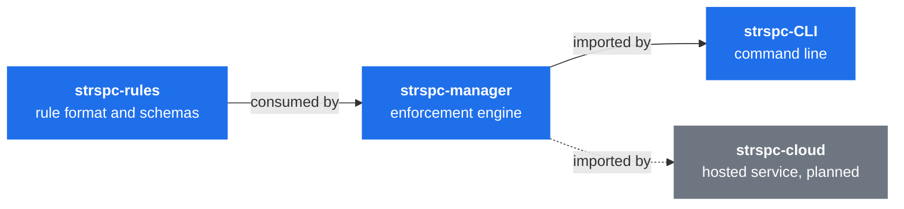

<div align="center">


# SteerSpec

**AI configuration as code — versioned, templated, and synchronized across your entire org.**

[](https://steerspec.dev)
[](https://github.com/SteerSpec/.github/blob/main/LICENSE)
[](https://github.com/marketplace/actions/pr-auto-approve-copilot)

[Why](#why) · [Architecture](#architecture) · [Repositories](#repositories) · [Status](#status) · [Get started](#get-started)

</div>

## Why

Your `CLAUDE.md` drifts. `.claude/agents/` mutates. New repos miss critical setup. SteerSpec treats
AI configuration files like infrastructure: define once in a central manifest, propagate everywhere
by pull request, detect drift on a schedule.

> *Because vibe coding without a spec is just vibing.*

## Architecture



Dependencies point one way and releases land in the same order. The rules are defined in
[strspc-spec](https://github.com/SteerSpec/strspc-spec), a SteerSpec realm of its own.

## Repositories

| Repo | What it does | Lang |
| ---- | ------------ | ---- |
| [**strspc-rules**](https://github.com/SteerSpec/strspc-rules) | Canonical rule format — self-referential rule definitions and schemas | Python |
| [**strspc-manager**](https://github.com/SteerSpec/strspc-manager) | Core enforcement engine — rule-lint, rule-diff, rule-eval, rule-resolve | Go |
| [**strspc-CLI**](https://github.com/SteerSpec/strspc-CLI) | User-facing CLI — render, validate and manage rule files | Go |
| [**strspc-sync**](https://github.com/SteerSpec/strspc-sync) | GitHub Action & CLI — template distribution by PR, drift monitoring, conflict detection | Go |
| [**strspc-pr-review**](https://github.com/SteerSpec/strspc-pr-review) | GitHub Action — auto-approve PRs on Copilot's review verdict | JavaScript |
| [**strspc-spec**](https://github.com/SteerSpec/strspc-spec) | Platform specification — the cross-cutting rules every repo follows | JSON |
| [**.claude**](https://github.com/SteerSpec/.claude) | Shared Claude Code agents, skills and settings — installable plugin marketplace | Markdown |
| [**homebrew-tap**](https://github.com/SteerSpec/homebrew-tap) | Homebrew tap for installing the `strspc` CLI on macOS | Ruby |

## Status

SteerSpec is under active development, and much of it ships today.

| Component | State |
| --------- | ----- |
| Rule format and core engine | Published |
| `strspc-sync` | Template distribution by PR, drift monitoring, fleet-wide conflict flags |
| `strspc-pr-review` | On the [GitHub Marketplace](https://github.com/marketplace/actions/pr-auto-approve-copilot) |
| CLI | Renders, lints and diffs rule files; AI evaluation of changes is planned |
| Hosted API | Planned, not yet built |

Things will change. Feedback welcome.

## Get started

```bash
brew tap SteerSpec/tap
brew trust --cask steerspec/tap/strspc
brew install --cask strspc
strspc init
```

Recent Homebrew refuses casks from untrusted taps, so the `brew trust` step is needed once. See
[Tap Trust](https://docs.brew.sh/Tap-Trust).

Full docs and guides live at **[steerspec.dev](https://steerspec.dev)**.

<div align="center">

Everything public here is Apache 2.0.

</div>
